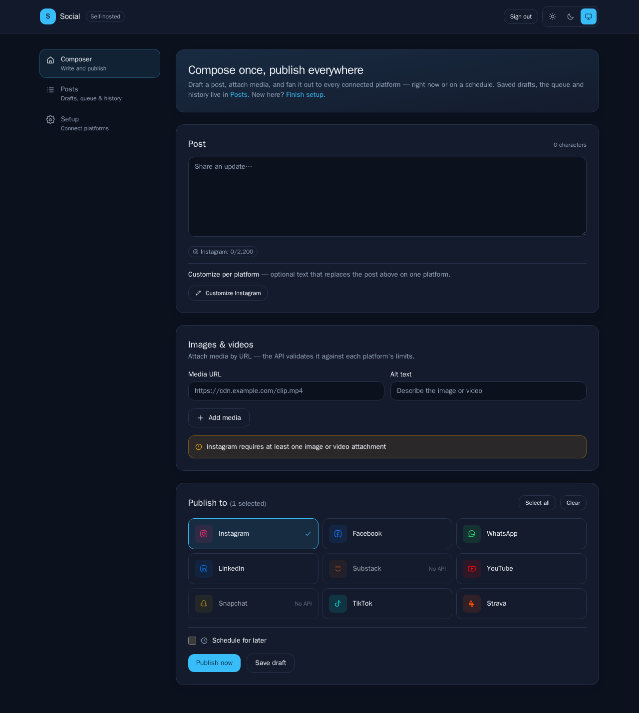
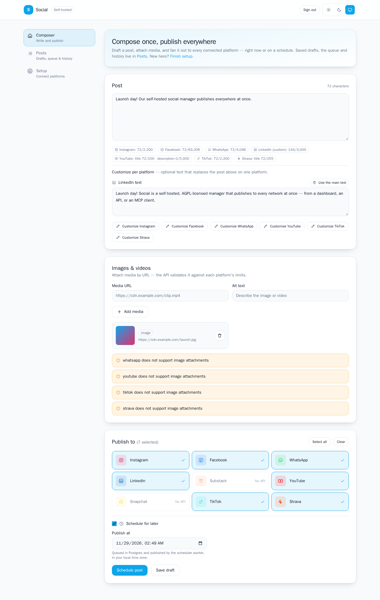
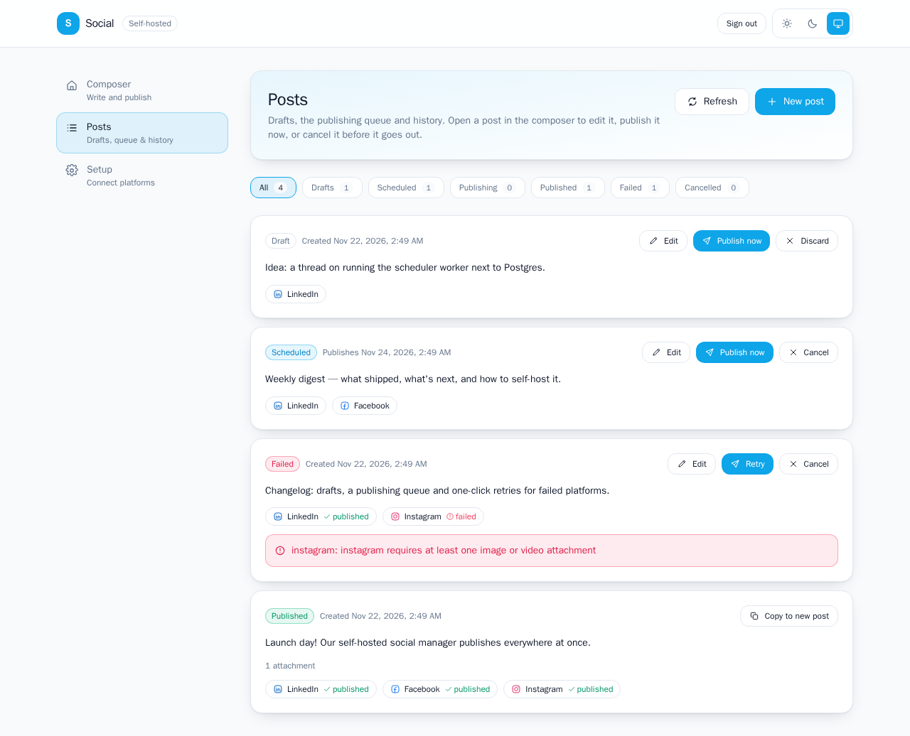
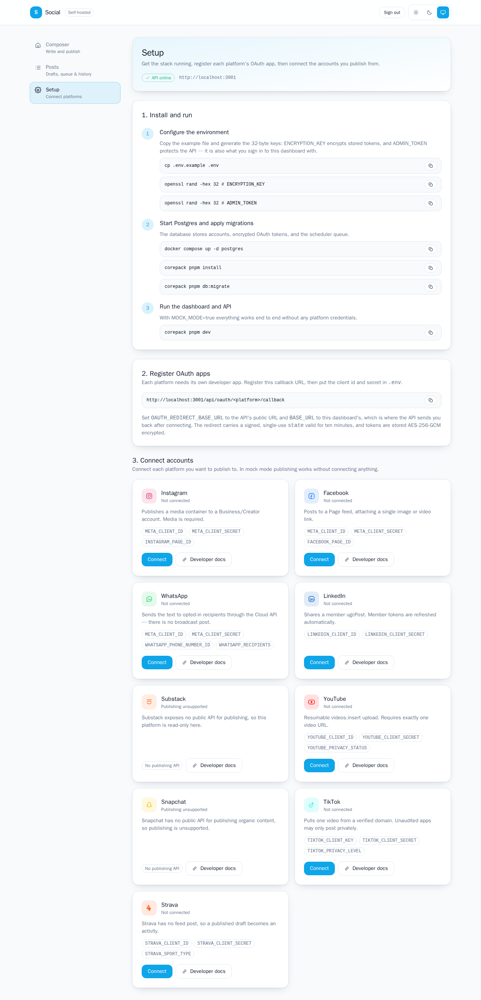

# Social

AGPL-3.0 self-hosted social-media manager with a Next.js dashboard, Fastify API, and MCP server.

**Live demo: https://charles2ke.github.io/social/** — a static export of the
dashboard published automatically from `main` (see "Deploying the demo to
GitHub Pages"). It is UI-only: there is no API or database behind it, so
publishing does nothing.

| Composer (dark) | Composing a post (light) |
| --- | --- |
|  |  |
| **Posts** | **Setup** |
|  |  |

The dashboard has three pages — **Composer** (`/`), **Posts** (`/posts`) and
**Setup** (`/setup`) — with light, dark and system themes selectable from the
header. Composer writes the post, attaches media by URL (with previews and
live per-platform compatibility warnings), picks the target platforms,
optionally customizes the text per platform with live character counts
against each platform's limit, and publishes immediately, saves a draft, or
queues the post for a date and time you choose. Posts lists drafts, the
publishing queue and history with each platform's outcome: open a post in the
composer to edit it, publish it now, retry the platforms that failed, or
cancel it. Setup shows whether the API is reachable, the install commands, the
OAuth callback URL to register, and a card per platform with its required
environment variables, its connection status, and **Connect** /
**Disconnect** buttons. When the API has an `ADMIN_TOKEN`, the dashboard
first asks for it and trades it for a short-lived session (see
"Authentication").

## Features

- **Compose once, publish everywhere** — one draft fans out to Facebook,
  Instagram, LinkedIn, WhatsApp, YouTube, TikTok and Strava. Customize the
  text per platform, with live character counts against each platform's
  limit; the API enforces the same limits before anything is sent.
- **Durable scheduling** — queued posts live in Postgres and are published by a
  separate worker with claim leases, retries with backoff, and cancellation.
  Schedule from the dashboard, the API, or an MCP client.
- **Drafts, queue and history** — save drafts and come back to them, and see
  every post with each platform's result. Edit, publish or cancel anything
  that hasn't gone out; retrying a partly failed post skips the platforms
  that already succeeded.
- **Media validation up front** — attachments are checked against each
  platform's constraints before anything is sent.
- **Encrypted credentials** — OAuth tokens are AES-256-GCM encrypted at rest,
  refreshed automatically, and redacted from logs and API responses. Connect
  and disconnect accounts from the dashboard's Setup page.
- **Signed-in dashboard** — the admin token is exchanged for a short-lived
  session token, so the token itself is never stored in the browser.
- **Hardened by default** — rate limits (tighter on sign-in and the OAuth
  callback), a CORS allow-list, strict security headers, request size limits,
  signed single-use OAuth state, and a least-privilege database role for the
  worker. See [`SECURITY.md`](SECURITY.md) for the deployment checklist.
- **Mock mode** — a full end-to-end demo with no platform credentials.
- **MCP server** — drive drafts, publishing, scheduling and analytics from an
  MCP client such as Claude Desktop or VS Code, through the same API.
- **Self-hosted** — AGPL-3.0, runs from a single `docker compose up --build`
  in non-root, read-only containers.

## Contents

- [Quick start](#quick-start)
- [Running with Docker](#running-with-docker)
- [Repository layout](#repository-layout)
- [Configuration](#configuration)
- [Authentication](#authentication)
- [Platform integrations](#platform-integrations)
- [API reference](#api-reference)
- [Database](#database)
- [Images and videos](#images-and-videos)
- [Scheduling](#scheduling)
- [MCP](#mcp)
- [Development](#development)
- [Troubleshooting](#troubleshooting)
- [Contributing, security and license](#contributing-security-and-license)

```text
Dashboard (apps/web) ─┐
                      ├─► API (apps/api) ──────────────────┬─► platform adapters (packages/core) ─► social platforms
MCP server (stdio) ───┘                                    │
                                                           └─► PostgreSQL via Prisma (packages/db)
Scheduler worker (apps/api/src/worker.ts) ─► the same adapters and database, as the social_worker role
```

## Quick start

Requirements: Node.js 20.19+, 22.13+ or 24+ (CI uses 22), [pnpm](https://pnpm.io) 9, and Docker.

1. Copy `.env.example` to `.env`, retain `MOCK_MODE=true`, and set
   `ENCRYPTION_KEY` to 64 hex characters (`openssl rand -hex 32`). Leave
   `ADMIN_TOKEN` empty for an open local demo, or set one (at least 32
   characters) to try the sign-in screen. The workspace scripts load the root
   `.env` themselves; variables already set in your shell take precedence.
2. Start Postgres: `docker compose up -d postgres` (this also creates the
   least-privilege `social_worker` role automatically — see "Database"
   below).
3. Run `corepack pnpm install`, apply migrations with
   `corepack pnpm db:migrate`, then `corepack pnpm dev`. Start the scheduler
   worker alongside them with `corepack pnpm --filter @social/api run dev:worker`
   so scheduled posts actually publish.
4. Open http://localhost:3000. The API runs on port 3001. To run everything
   in containers instead, see "Running with Docker".

Mock mode provides safe demo tokens/accounts and never contacts a platform,
so you get a working end-to-end demo with **no social platform credentials
configured**. Production deployments must use HTTPS, a strong `ADMIN_TOKEN`,
and platform credentials — follow the deployment checklist in
[`SECURITY.md`](SECURITY.md). Tokens are encrypted with AES-256-GCM before
persistence; errors must not include token values.

## Running with Docker

`docker compose up --build` runs the whole stack: Postgres, a one-off
`migrate` job, the API on port 3001, the dashboard on port 3000, and the
scheduler worker.

1. Copy `.env.example` to `.env` and set `ENCRYPTION_KEY`. Set `ADMIN_TOKEN`
   too unless this is only the mock-mode demo.
2. Run `docker compose up --build -d` and open http://localhost:3000.
   `docker compose down` stops everything; add `-v` to delete the database
   volume as well.

How it fits together:

- The `migrate` service builds the one image (`social-app:local`) that the
  API, dashboard and worker all run, applies pending migrations, and exits;
  the other services start once it succeeds. Pass `--build` after pulling
  changes so the image is rebuilt.
- `NEXT_PUBLIC_API_URL` — the API URL the browser calls — is baked into the
  dashboard when the image is built. Set it in `.env` (Compose reads it from
  there) and rebuild after changing it.
- The containers run as the unprivileged `node` user with a read-only root
  filesystem, every Linux capability dropped, and `no-new-privileges`. The
  dashboard container receives no secrets, and the worker connects as the
  least-privilege `social_worker` role (override its connection string with
  `WORKER_DATABASE_URL_CONTAINER`).
- Every port is published on 127.0.0.1 only. To serve other machines, put a
  TLS-terminating reverse proxy in front, set `TRUST_PROXY`, and point
  `BASE_URL`, `WEB_ORIGIN`, `OAUTH_REDIRECT_BASE_URL` and
  `NEXT_PUBLIC_API_URL` at the public URLs.
- The bundled Postgres uses `trust` authentication, which is only safe on a
  single-user machine. In production, use a managed or password-protected
  database with TLS (see the `sslmode=require` example in `.env.example`).

## Repository layout

A pnpm workspace monorepo:

| Path | Contents |
| --- | --- |
| [`apps/web`](apps/web) | Next.js dashboard (Composer, Posts and Setup pages) and its Playwright end-to-end tests |
| [`apps/api`](apps/api) | Fastify API (`src/index.ts`) and scheduler worker (`src/worker.ts`) |
| [`packages/core`](packages/core) | Platform adapters, OAuth, crypto, media rules, shared types |
| [`packages/db`](packages/db) | Prisma schema, migrations, scheduler claim loop |
| [`packages/mcp-server`](packages/mcp-server) | MCP stdio server |
| [`docs/adr`](docs/adr) | Architecture decision records |

Workspace scripts (run from the root, prefixed with `corepack pnpm`):

| Script | Purpose |
| --- | --- |
| `dev` | Run the web app and API together |
| `build`, `lint`, `typecheck`, `test` | Validate every workspace |
| `e2e` | Build the dashboard and run its Playwright tests against a mock API (see "Development") |
| `db:generate` | Generate the Prisma client (needed before `typecheck`) |
| `db:migrate` | Apply migrations |
| `db:studio` | Open Prisma Studio |

## Configuration

Every setting lives in `.env` — [`.env.example`](.env.example) documents all of
them, including per-platform OAuth credentials. The ones that matter most:

| Variable | Default | Purpose |
| --- | --- | --- |
| `MOCK_MODE` | `false` | Run every adapter against local mocks — no credentials needed (`.env.example` sets it to `true` for the demo) |
| `ENCRYPTION_KEY` | — | 64 hex chars (`openssl rand -hex 32`), AES-256-GCM key for stored tokens; the API refuses to start without a valid one when `DATABASE_URL` is set |
| `ADMIN_TOKEN` | — | The API's admin credential, at least 32 characters; required outside mock mode (see "Authentication") |
| `SESSION_TTL_HOURS` | `12` | How long a dashboard sign-in lasts |
| `DATABASE_URL` | — | Prisma connection string; without it the API uses an in-memory store |
| `WORKER_DATABASE_URL` | `DATABASE_URL` | Least-privilege connection string for the worker |
| `BASE_URL` | — | The dashboard's public URL, where the browser lands after connecting an account |
| `OAUTH_REDIRECT_BASE_URL` | `BASE_URL` | The API's public URL, used to build OAuth callback URLs (`<url>/api/oauth/<platform>/callback`) |
| `WEB_ORIGIN` | `http://localhost:3000` in mock mode | Comma-separated browser origins allowed to call the API (CORS) and to be returned to after connecting an account; unset outside mock mode means no cross-origin browser access |
| `NEXT_PUBLIC_API_URL` | `http://localhost:3001` | The API URL the dashboard calls — baked in when the dashboard is built |
| `API_HOST` | `0.0.0.0` with an `ADMIN_TOKEN`, otherwise `localhost` | Interface the API listens on, so an open mock-mode API stays local |
| `API_PORT` | `3001` | Port the API listens on |
| `TRUST_PROXY` | `false` | Behind a reverse proxy: a hop count, `true`, or comma-separated proxy addresses/CIDRs whose `X-Forwarded-*` headers to trust |
| `OAUTH_STATE_SECRET` | `ADMIN_TOKEN`, else a random key per process | HMAC key signing the OAuth `state` value |
| `API_RATE_LIMIT`, `SESSION_RATE_LIMIT`, `OAUTH_CALLBACK_RATE_LIMIT` | `300`, `10`, `20` | Requests per minute per client IP: overall, sign-in attempts, and the OAuth callback |
| `API_BODY_LIMIT` | `1048576` | Largest request body the API accepts, in bytes |
| `WORKER_POLL_INTERVAL_MS` | `15000` | Scheduler tick cadence |
| `WORKER_BATCH_SIZE` | `5` | Posts claimed per tick |

## Authentication

Outside mock mode, `ADMIN_TOKEN` is required — the API refuses to start
without it, or with one shorter than 32 characters. Every route except
`/health`, `/ready`, the sign-in routes and the OAuth callback (which is
authenticated by its signed `state`) then needs an
`Authorization: Bearer <credential>` header, where the credential is either
the admin token itself (for scripts and the MCP server) or a dashboard
session token. In mock mode without an `ADMIN_TOKEN`, the API is open and
listens on localhost only.

The dashboard shows a sign-in screen when the API requires a token. The admin
token you enter is sent once to `POST /auth/session` and exchanged for a
signed session token that expires after `SESSION_TTL_HOURS`; the admin token
itself is never stored. The session is kept in the tab's `sessionStorage`,
so the browser forgets it when the tab closes, and **Sign out** in the
header also revokes it on the API. When a session expires mid-edit, the
sign-in screen covers the page without discarding unsaved work.

Things to know when operating it:

- Session tokens are signed with a key derived from `ADMIN_TOKEN`, so
  rotating `ADMIN_TOKEN` ends every session at once.
- Signing out is remembered by the API process that handled it. After that
  process restarts, or on another API replica, a signed-out session token
  stays valid until it expires — keep `SESSION_TTL_HOURS` short, or rotate
  `ADMIN_TOKEN` to revoke everything.
- Sign-in attempts are limited to `SESSION_RATE_LIMIT` per minute per client
  IP, and token comparisons are constant-time.

## Platform integrations

Each platform is a `PlatformSpec` in
[`packages/core/src/adapters`](packages/core/src/adapters) wrapped by
`ApiAdapter`, which handles OAuth, mock mode, per-platform draft overrides,
and token redaction. `fetch` and the environment are injected, so the API
clients are unit-tested without network access.

| Platform | Publishing | Media | Analytics | Notes |
| --- | --- | --- | --- | --- |
| Facebook | Page feed (`/{page-id}/feed`) | image *or* video, up to 10 | Post insights + like/comment counts | Long-lived tokens are exchanged, not refreshed. [Meta apps](https://developers.facebook.com/docs/) |
| Instagram | Media container + `media_publish` | image/video, up to 10, required | Media insights + counts | Requires media — the API has no text-only post. Needs a Business/Creator account |
| LinkedIn | `ugcPosts` share | up to 9 images *or* 1 video | Social actions (likes/comments) | Refreshable member tokens. [LinkedIn apps](https://www.linkedin.com/developers/) |
| WhatsApp | Cloud API text message | — | — | Messages opted-in `WHATSAPP_RECIPIENTS`; the [Cloud API](https://developers.facebook.com/docs/whatsapp/cloud-api) has no broadcast post |
| YouTube | Data API v3 resumable `videos.insert` | exactly 1 video (required) | Video statistics | Requires a video URL; visibility via `YOUTUBE_PRIVACY_STATUS` |
| TikTok | `/v2/post/publish/video/init/` (`PULL_FROM_URL`) | exactly 1 video (required) | `/v2/video/query/` | Unaudited apps may only post `SELF_ONLY`; the video URL must be on a verified domain |
| Strava | `POST /api/v3/activities` | — | — | Strava has no feed post type, so a post becomes an activity |
| Snapchat, Substack | Not supported | — | — | No public API for publishing organic content; both raise `UnsupportedOperation` |

The Facebook feed post and LinkedIn share currently publish text (Facebook
attaches a single media URL as a link); asset uploads through `/photos` and
LinkedIn's `registerUpload` flow are not implemented, so attaching media to a
LinkedIn post is rejected rather than silently dropped.

### Connecting an account

1. Register each platform's OAuth app with the callback
   `OAUTH_REDIRECT_BASE_URL/api/oauth/<platform>/callback` — the API's public
   URL; the Setup page shows the exact value — and set its client id/secret in
   `.env`.
2. On the dashboard's **Setup** page, click **Connect** on the platform's
   card. The dashboard asks the API for the consent URL
   (`GET /api/oauth/<platform>/start?returnTo=<page>` with
   `Accept: application/json`) and sends the browser there; other clients get
   a redirect from the same route. The `state` value is HMAC-signed, expires
   after ten minutes and is single-use (tracked per API process), which
   blocks CSRF and replayed callbacks. `returnTo` must be on `BASE_URL` or a
   `WEB_ORIGIN` origin, so the API is never an open redirect.
3. The callback exchanges the code, reads the platform profile, and stores the
   account with its **AES-256-GCM encrypted** access/refresh tokens (see
   `accounts` and `oauth_tokens` in [`packages/db`](packages/db)). It then
   sends the browser back to the page that started the flow (or
   `BASE_URL/setup`) with `?connected=<platform>`, or with `?oauth_error=`
   and a message when connecting failed. Tokens are refreshed automatically
   five minutes before expiry when publishing.

**Disconnect** on a card (or `POST /accounts/:id/disconnect`) deletes the
account's stored tokens, so it shows as not connected and nothing is
published to it until it is connected again. It does not revoke the app's
access on the platform itself — do that in the platform's settings as well.

The stored account id is the id the platform's *publishing* endpoints are
scoped to, which is not always the user who authorized the app: Facebook
resolves the Page from `/me/accounts`, and Instagram the Business account
linked to that Page. Set `FACEBOOK_PAGE_ID` / `INSTAGRAM_PAGE_ID` to choose
when an account administers several Pages; otherwise the first is used, and
connecting fails with an explanation when there is none.

The callback is the only unauthenticated write path, so it is rate limited
per client IP (`OAUTH_CALLBACK_RATE_LIMIT`, default 20/minute). Platform
responses and errors are passed through `redactSecrets` so that tokens never
reach logs or API responses.

Drafts and scheduled posts are stored in Postgres when `DATABASE_URL` is set;
without it the API falls back to an in-memory store for the mock-mode demo,
and nothing is published by the worker.

## API reference

Every route except `/health`, `/ready`, `/auth/session` and the OAuth
callback requires authentication (see "Authentication"). Request and
response bodies are JSON.

| Route | Purpose |
| --- | --- |
| `GET /health` | Liveness probe (public) |
| `GET /ready` | Readiness, including database connectivity (public; 503 when the database is down) |
| `GET /auth/session` | Whether sign-in is required and whether the presented credential is valid (public) |
| `POST /auth/session` | Exchange `{ token }` (the `ADMIN_TOKEN`) for `{ token, expiresAt }`, a dashboard session (public, rate limited) |
| `POST /auth/logout` | Revoke the presented session token |
| `GET /platforms` | Supported platforms, capabilities, media constraints and text limits |
| `GET /accounts` | Connected accounts (tokens are never returned) |
| `POST /accounts/:id/disconnect` | Delete an account's stored tokens |
| `GET /api/oauth/:platform/start` | Start connecting an account: redirects to the platform's consent screen, or returns `{ url }` when asked for JSON; optional `returnTo` dashboard URL |
| `GET /api/oauth/:platform/callback` | OAuth callback (authenticated by its signed `state`) |
| `GET /drafts`, `POST /drafts` | List drafts; save `{ text, media, platforms?, platformOverrides? }` as a draft |
| `POST /drafts/:id` | Edit a draft, scheduled or failed post in place; fields left out keep their values (409 with the post once it is publishing, published or cancelled). A scheduled post must keep at least one platform and fit their text limits |
| `POST /media/validate` | Per-platform compatibility report for a draft's media |
| `POST /publish` | Publish without saving a post; returns a per-platform `status` |
| `POST /schedule` | Queue a post for the worker |
| `GET /posts`, `GET /posts/:id` | List posts (newest first) and inspect one with its per-platform attempts |
| `POST /posts/:id/publish` | Publish a saved post now, optionally applying `{ text, media, platforms, platformOverrides }` first; returns `{ post, results }` |
| `POST /posts/:id/cancel` | Cancel a draft, scheduled or failed post |
| `GET /analytics/:platform/:postId` | Metrics for a published post |

`platformOverrides` replaces the text for individual platforms, for example
`{ "text": "Full announcement…", "platformOverrides": { "linkedin": { "text": "Longer LinkedIn version…" } } }`.
Blank overrides are dropped and unknown platforms are rejected. Drafts and
failed posts may go over a platform's limit while you edit them, but
publishing, scheduling, or editing a scheduled post is refused with a 400 when
the text (or an override) is longer than a target platform allows, before
anything is published. Saving a post with `platformOverrides`
replaces all of its overrides; `{}` removes them.

## Database

The persistence layer is **PostgreSQL, accessed through Prisma** — see
[`docs/adr/0001-database.md`](docs/adr/0001-database.md) for the full
security/reliability/performance rationale (short version: the DB stores
OAuth refresh tokens for 9 platforms and a background scheduler writes
concurrently with the web app, which is exactly the profile Postgres is
built for).

The Prisma schema, migrations, and scheduler claim-loop live in
[`packages/db`](packages/db).

### Running tests

```bash
pnpm test
```

Each test file in `packages/db` gets its own throwaway Postgres schema
(see `packages/db/test/setup.ts`), so tests can run against any bare
Postgres instance — including the one started by
`docker compose up -d postgres` above — with no hand-provisioned database
or seed data. CI provisions Postgres via a GitHub Actions service
container (see `.github/workflows/ci.yml`).

### Least-privilege worker role

`packages/db/prisma/init/01-social-worker-role.sql` creates a
`social_worker` Postgres role with nothing but `CONNECT` and schema `USAGE`;
the `postgres` service applies it on first boot (it is mounted into
`/docker-entrypoint-initdb.d`). The table privileges come from the
`20261001000000_social_worker_grants` migration, because init scripts run
before the tables exist. They are scoped to what the scheduler needs:

| Table | `social_worker` may |
| --- | --- |
| `posts` | read and update (claim, complete, fail) — never insert or delete |
| `platform_publish_attempts` | read, insert and update |
| `accounts` | read |
| `oauth_tokens` | read, and update only the token columns of an existing row (a publish whose access token expired refreshes it) — never create or delete token rows |
| `analytics_snapshots` | nothing |

The migration skips the grants when the role does not exist. If you create
the role later, apply them with `corepack pnpm --filter @social/db run grant:worker`.

To have the scheduler worker connect using this role instead of the
database owner, set `WORKER_DATABASE_URL` in `.env` to a connection
string using the `social_worker` role; the worker prefers it over
`DATABASE_URL`. Under `docker compose`, the `worker` service already points
at `social_worker` on the compose network — override it with
`WORKER_DATABASE_URL_CONTAINER` to supply real credentials. Give the role a real password
out-of-band in production (`ALTER ROLE social_worker WITH PASSWORD '...'`)
— never commit one.

### Connection pooling

The API and the scheduler worker are separate processes and each open
their own Prisma connection pool (the dashboard and the MCP server only
talk to the API). `packages/db`'s `createPrismaClient()`
sizes the pool from `DATABASE_CONNECTION_LIMIT` (default 5) — set this
per-process in each service's environment.

In production, put [PgBouncer](https://www.pgbouncer.org/) in front of
Postgres and point both processes at it instead of the database directly.
When PgBouncer runs in transaction pooling mode, append `pgbouncer=true`
to `DATABASE_URL` so Prisma disables features that don't work with
statement-level pooling (see the commented example in `.env.example`).

## Images and videos

Posts carry typed attachments: `media: [{ url, kind: "image" | "video", altText? }]`.
`kind` is inferred from the URL extension when you use the legacy
`mediaUrls: string[]` field, so existing callers keep working — a URL with an
unrecognised extension must declare its `kind` explicitly. Only `http(s)`
URLs are accepted; media is referenced by URL and fetched by the platform,
so the app never proxies uploads.

Every adapter declares `mediaConstraints` (`maxAttachments`,
`allowsMixedKinds`, `requiresMedia`, `requiresKind`) next to its
capabilities, and `publish()` rejects incompatible media before contacting a
platform — for example an image sent to TikTok, ten attachments on LinkedIn,
or a YouTube post with no video. `GET /platforms` and the MCP
`list_platforms` tool return those constraints, `POST /media/validate`
reports per-platform compatibility for a draft (the dashboard uses it to warn
while you compose), and `POST /publish` returns a per-platform
`status: "published" | "failed"` instead of failing the whole request.

## Scheduling

Scheduling is durable: `POST /schedule` writes the post to the `posts` table
and a **separate scheduler worker process** publishes it. In the dashboard,
tick **Schedule for later** in the composer and pick a date and time (entered
in your local time zone and sent to the API as UTC). The **Posts** page shows
the queue: open a scheduled post in the composer to change it or its time,
publish it straight away, or cancel it. Without `DATABASE_URL` the API keeps
posts in memory, where nothing scheduled is ever published, and the dashboard
says so.

| Route | Purpose |
| --- | --- |
| `POST /schedule` | Queue `{ text, media, platforms, platformOverrides?, scheduledFor }`, or `{ id, platforms, scheduledFor }` for a saved draft, scheduled or failed post — text, media or overrides left out keep their saved values |
| `GET /posts?status=scheduled` | List posts, optionally filtered by status |
| `GET /posts/:id` | A post with its per-platform publish attempts and last error |
| `POST /posts/:id/publish` | Publish a draft, scheduled or failed post now instead of waiting (409 once it is publishing, published or cancelled) |
| `POST /posts/:id/cancel` | Cancel a post that the worker has not claimed yet (409 once it is publishing or published) |

Run the worker with `corepack pnpm --filter @social/api run start:worker`
(`dev:worker` in development, or the `worker` service in
`docker-compose.yml`). Each tick it:

1. requeues posts whose claim lease expired because their worker died
   (`releaseStaleClaims`), failing them once `max_attempts` is used up;
2. claims due posts with `SELECT ... FOR UPDATE SKIP LOCKED`, so any number
   of worker replicas can poll the same table without double-publishing;
3. publishes to each target platform that has not already succeeded, writing
   one `platform_publish_attempts` row per post/platform — the unique
   `(post_id, platform)` key makes a retry idempotent, so a partially
   published post never re-posts where it already succeeded;
4. marks the post `PUBLISHED`, or reschedules it with exponential backoff
   (`WORKER_POLL_INTERVAL_MS`, `WORKER_BATCH_SIZE`) until `max_attempts`.

Publishing now — the dashboard's **Publish now** and **Retry** buttons, or
`POST /posts/:id/publish` — takes the same claim lease as the worker, so the
worker cannot pick the post up mid-publish, and if the API dies before
finishing, the expired lease hands the post to the worker. It goes through
the same per-platform loop, so a retry skips platforms that already
succeeded, but it is not retried with backoff: if any platform fails, the
post is marked `FAILED` straight away for you to fix and retry. Requeuing a
failed post with `POST /schedule` gives it a fresh set of attempts.

Errors stored on a post or an attempt are passed through `redactSecrets`, so
tokens never reach the database or the API response.

## MCP

The MCP server (`packages/mcp-server`) is a stdio client of the API, so it
works with the same connected accounts, drafts and scheduling queue as the
dashboard. It exposes the tools `list_platforms`, `list_accounts`,
`get_account_status`, `create_draft`, `update_draft`, `list_drafts`,
`publish_post`, `publish_draft`, `schedule_post`, `list_scheduled`,
`cancel_scheduled`, `get_post_status` and `get_analytics`, the
`social://accounts` and `social://posts/{id}` resources, and the
`cross_platform_announcement` prompt. Drafts and posts accept the same
`platformOverrides` as the API.

```json
{ "mcpServers": { "social": { "command": "node", "args": ["/absolute/path/to/social/packages/mcp-server/dist/mcp-server/src/index.js"], "env": { "SOCIAL_API_URL": "http://localhost:3001", "SOCIAL_API_TOKEN": "the API's ADMIN_TOKEN" } } } }
```

Use this in `claude_desktop_config.json` or VS Code MCP settings after
`corepack pnpm build`, with the API running. `SOCIAL_API_URL` defaults to
`http://localhost:3001`; `SOCIAL_API_TOKEN` can be omitted for an open
mock-mode API. Use an `https://` URL for any API that is not on this
machine — the server warns when the token would travel over plain HTTP.

## Development

`corepack pnpm lint`, `typecheck`, `test`, and `build` validate all workspaces.
The scheduler worker persists per-platform results (including errors), and
its queue supports cancellation and bounded retries through the API (see
"Scheduling"). `apps/api` tests cover the worker loop against a real
Postgres, so `pnpm test` needs the `postgres` service running. Tests don't
read `.env`: they use `TEST_DATABASE_URL` or `DATABASE_URL` from the shell,
defaulting to `postgresql://social@localhost:5432/social`, and create a
throwaway schema per test file.

The `dev`, `start`, `build` (dashboard) and database scripts run through
`scripts/with-env.mjs`, which loads the root `.env` without overriding
variables that are already set — so the shell, CI and Compose keep the
final say.

### End-to-end tests

`corepack pnpm e2e` builds the dashboard for production and drives it in
Chromium with [Playwright](https://playwright.dev) against a mock-mode API
that keeps posts in memory, on ports 3200 and 3201 (override them with
`E2E_WEB_PORT` and `E2E_API_PORT`). The API runs with a fixed test
`ADMIN_TOKEN`, so the sign-in flow is exercised too. The build replaces
`apps/web/.next`, which `next dev` also uses, so stop `corepack pnpm dev`
first. Install the browser once with
`corepack pnpm --filter @social/web exec playwright install --with-deps chromium`.

The tests save full-page screenshots of each step to
`apps/web/test-results/screenshots`, and the HTML report goes to
`apps/web/playwright-report`. CI runs the suite in the `e2e` job and uploads
both as the `playwright-report` artifact.

The screenshots at the top of this README come from the same suite:
`DOCS_SCREENSHOTS=1 corepack pnpm e2e docs-screenshots` regenerates
`docs/screenshots/*.png`. It starts its own servers on the default ports
3000 and 3001, so the Setup page shows the usual URLs.

### Deploying the demo to GitHub Pages

`.github/workflows/pages.yml` builds `apps/web` as a static export and
publishes it to GitHub Pages on every push to `main` (and on demand via
*Run workflow*). Enable it once per fork under **Settings → Pages → Build
and deployment → Source: GitHub Actions**.

The export is opt-in: `apps/web/next.config.mjs` only sets Next.js'
`output: "export"` when `NEXT_STATIC_EXPORT=true`, and prefixes assets with
`NEXT_BASE_PATH` (the workflow passes `/<repository>` for project Pages), so
`pnpm dev` and self-hosted deployments keep the normal server build. To
reproduce the published site locally:

```bash
NEXT_STATIC_EXPORT=true NEXT_BASE_PATH=/social corepack pnpm --filter @social/web run build
```

The result lands in `apps/web/out`. Because Pages serves static files only,
the deployed dashboard has no API to call — run the full stack locally or
self-host it for a working install.

## Troubleshooting

| Symptom | Fix |
| --- | --- |
| `typecheck` fails in `packages/db` with missing `@prisma/client` exports | Run `corepack pnpm db:generate` first |
| `pnpm test` fails to connect to Postgres | Start it with `docker compose up -d postgres` — `apps/api` and `packages/db` tests use a real database |
| `pnpm e2e` fails because the browser executable doesn't exist | Install it with `corepack pnpm --filter @social/web exec playwright install --with-deps chromium` |
| API exits at startup complaining about `ADMIN_TOKEN` | Set `ADMIN_TOKEN` (at least 32 characters: `openssl rand -hex 32`), or keep `MOCK_MODE=true` for the demo |
| API exits at startup complaining about `ENCRYPTION_KEY` | With `DATABASE_URL` set it must be 64 hex characters: `openssl rand -hex 32` |
| Dashboard says it cannot reach the API, but the API is running | Add the dashboard's origin to `WEB_ORIGIN` (CORS), and check that `NEXT_PUBLIC_API_URL` was the API's URL when the dashboard was built |
| Sign-in says "Too many sign-in attempts" | Wait a minute (`SESSION_RATE_LIMIT`). Behind a reverse proxy, set `TRUST_PROXY` so the limit applies per client rather than to the proxy |
| Everyone is signed out at once | `ADMIN_TOKEN` changed, which invalidates every session — sign in with the new token |
| Scheduled posts stay `SCHEDULED` | The worker is not running (`corepack pnpm --filter @social/api run dev:worker`) or `DATABASE_URL` is unset, so posts only live in memory |
| OAuth callback returns an error | The registered callback must match `OAUTH_REDIRECT_BASE_URL/api/oauth/<platform>/callback` exactly (the Setup page shows it), and that URL must be the API's, reachable by your browser |
| Connecting fails with `returnTo must be a dashboard URL…` | Add the dashboard's origin to `WEB_ORIGIN` or set `BASE_URL` to it |
| Connecting Facebook/Instagram fails with "no Page" | The authorizing user must administer a Page; set `FACEBOOK_PAGE_ID` / `INSTAGRAM_PAGE_ID` when there are several |

## Contributing, security and license

Issues and pull requests are welcome. Before opening one, run
`corepack pnpm lint`, `typecheck`, `test` and `build`, and keep changes
focused. Architectural decisions are recorded in [`docs/adr`](docs/adr).

Report vulnerabilities privately as described in
[`SECURITY.md`](SECURITY.md) — never in a public issue. Never commit real
credentials; `.env` is git-ignored and `.env.example` holds placeholders only.

Licensed under the [GNU AGPL-3.0](LICENSE): if you run a modified version as a
network service, you must offer its source to users of that service.
