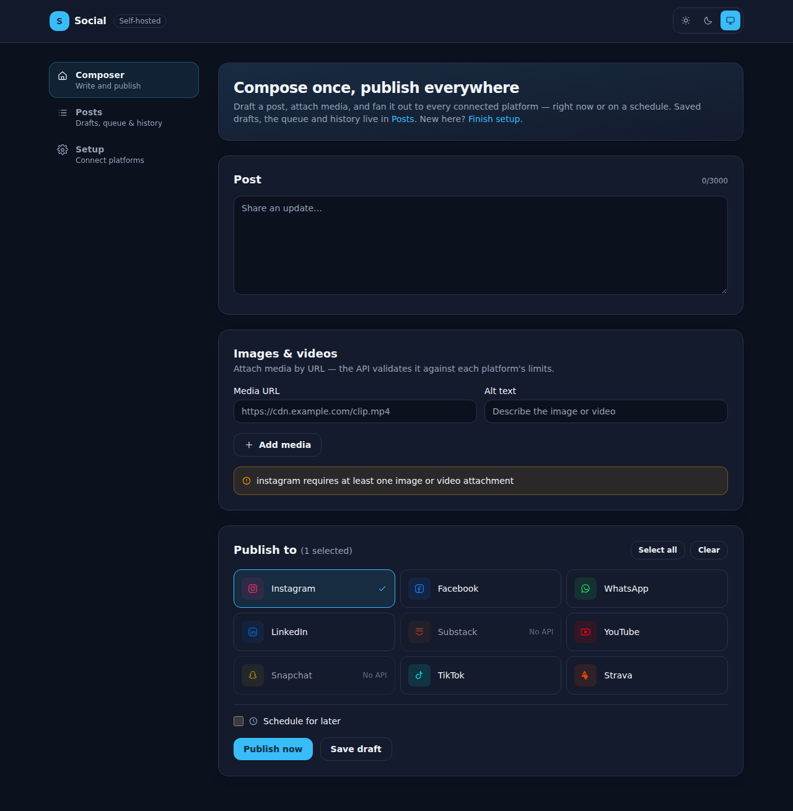
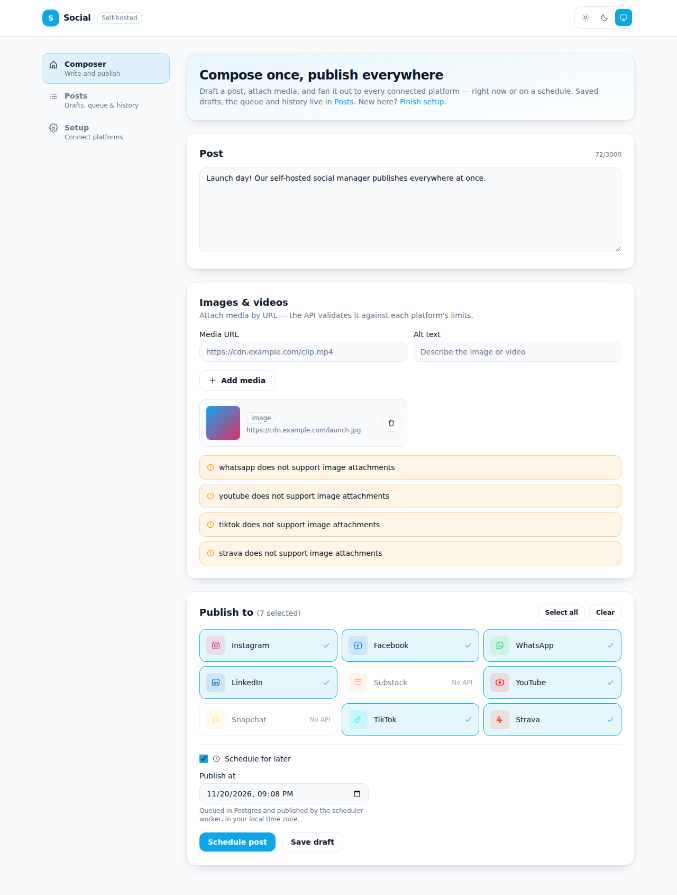
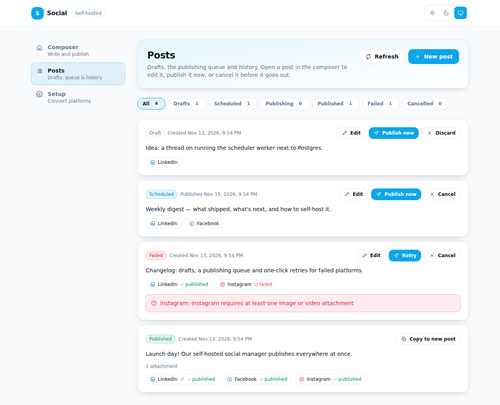
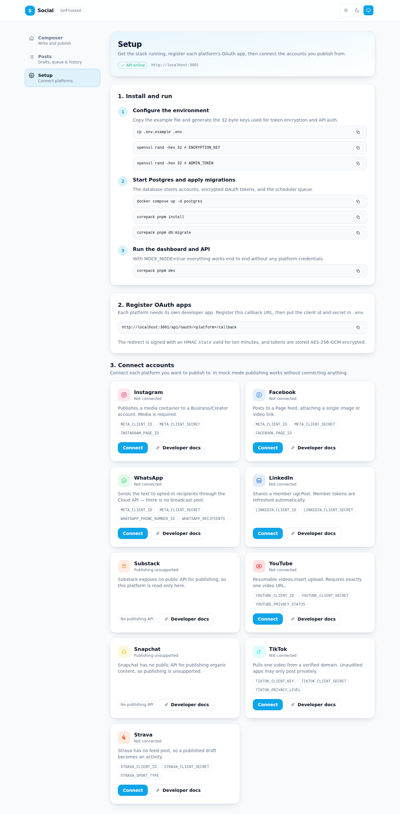

# Social

AGPL-3.0 self-hosted social-media manager with a Next.js dashboard, Fastify API, and MCP server.

**Live demo: https://charles2ke.github.io/social/** — a static export of the
dashboard published automatically from `main` (see "Deploying the demo to
GitHub Pages"). It is UI-only: there is no API or database behind it, so
publishing does nothing.

| Composer (dark) | Composing a post (light) |
| --- | --- |
|  |  |
| **Posts** | **Setup** |
|  |  |

The dashboard has three pages — **Composer** (`/`), **Posts** (`/posts`) and
**Setup** (`/setup`) — with light, dark and system themes selectable from the
header. Composer writes the post, attaches media by URL (with previews and
live per-platform compatibility warnings), picks the target platforms, and
publishes immediately, saves a draft, or queues the post for a date and time
you choose. Posts lists drafts, the publishing queue and history with each
platform's outcome: open a post in the composer to edit it, publish it now,
retry the platforms that failed, or cancel it. Setup shows whether the API is
reachable, the install commands, the OAuth callback URL to register, and a
card per platform with its required environment variables and a connect link.

## Features

- **Compose once, publish everywhere** — one draft fans out to Facebook,
  Instagram, LinkedIn, WhatsApp, YouTube, TikTok and Strava. Customize the text
  or attachments for any one platform without touching the rest.
- **Durable scheduling** — queued posts live in Postgres and are published by a
  separate worker with claim leases, retries with backoff, and cancellation.
  Schedule from the dashboard, the API, or an MCP client.
- **Drafts, queue and history** — save drafts and come back to them, and see
  every post with each platform's result. Edit, publish or cancel anything
  that hasn't gone out; retrying a partly failed post skips the platforms
  that already succeeded.
- **Validation up front** — text and attachments are checked against each
  platform's documented limits before anything is sent, and the composer shows
  every platform's usage as you type. Text over a documented limit is
  rejected rather than cut short.
- **Encrypted credentials** — OAuth tokens are AES-256-GCM encrypted at rest,
  refreshed automatically, and redacted from logs and API responses.
- **Mock mode** — a full end-to-end demo with no platform credentials.
- **MCP server** — draft, publish and schedule posts from an MCP client such
  as Claude Desktop or VS Code. It works through the API, so it shares the
  dashboard's posts, connected accounts and scheduler.
- **Self-hosted** — AGPL-3.0, runs from a single `docker compose up`.

## Contents

- [Quick start](#quick-start)
- [Repository layout](#repository-layout)
- [Configuration](#configuration)
- [Platform integrations](#platform-integrations)
- [API reference](#api-reference)
- [Database](#database)
- [Images and videos](#images-and-videos)
- [Per-platform versions and text limits](#per-platform-versions-and-text-limits)
- [Scheduling](#scheduling)
- [MCP](#mcp)
- [Development](#development)
- [Troubleshooting](#troubleshooting)
- [Contributing, security and license](#contributing-security-and-license)

```text
Web (apps/web) ─────┐
MCP stdio server ───┴─► API (apps/api) ──► Core adapters/scheduler (packages/core)
                                           └── PostgreSQL / Prisma (packages/db)
```

## Quick start

Requirements: Node.js 20+, [pnpm](https://pnpm.io) 9, and Docker.

1. Copy `.env.example` to `.env`, retain `MOCK_MODE=true`, and choose a 32-byte hex `ENCRYPTION_KEY`.
2. Start Postgres: `docker compose up -d postgres` (this also creates the
   least-privilege `social_worker` role automatically — see "Database"
   below).
3. Run `corepack pnpm install`, apply migrations with
   `corepack pnpm db:migrate`, then `corepack pnpm dev`. Start the scheduler
   worker alongside them with `corepack pnpm --filter @social/api run dev:worker`
   so scheduled posts actually publish.
4. Open http://localhost:3000. The API runs on port 3001. Use
   `docker compose up --build` to run everything (Postgres + the app) in
   containers with a single command.

Mock mode provides safe demo tokens/accounts and never contacts a platform,
so you get a working end-to-end demo with **no social platform credentials
configured**. Production deployments must use HTTPS, a strong `ADMIN_TOKEN`,
and platform credentials. Tokens are encrypted with AES-256-GCM before
persistence; errors must not include token values.

## Repository layout

A pnpm workspace monorepo:

| Path | Contents |
| --- | --- |
| [`apps/web`](apps/web) | Next.js dashboard (Composer, Posts and Setup pages) and its Playwright end-to-end tests |
| [`apps/api`](apps/api) | Fastify API (`src/index.ts`) and scheduler worker (`src/worker.ts`) |
| [`packages/core`](packages/core) | Platform adapters, OAuth, crypto, media rules, shared types |
| [`packages/db`](packages/db) | Prisma schema, migrations, scheduler claim loop |
| [`packages/mcp-server`](packages/mcp-server) | MCP stdio server, a client of the API |
| [`docs/adr`](docs/adr) | Architecture decision records |

Workspace scripts (run from the root, prefixed with `corepack pnpm`):

| Script | Purpose |
| --- | --- |
| `dev` | Run the web app and API together |
| `build`, `lint`, `typecheck`, `test` | Validate every workspace |
| `e2e` | Build the dashboard and run its Playwright tests against a mock API (see "Development") |
| `db:generate` | Generate the Prisma client (needed before `typecheck`) |
| `db:migrate` | Apply migrations |
| `db:studio` | Open Prisma Studio |

## Configuration

Every setting lives in `.env` — [`.env.example`](.env.example) documents all of
them, including per-platform OAuth credentials. The ones that matter most:

| Variable | Default | Purpose |
| --- | --- | --- |
| `MOCK_MODE` | `false` | Run every adapter against local mocks — no credentials needed (`.env.example` sets it to `true` for the demo) |
| `ENCRYPTION_KEY` | — | 64 hex chars (`openssl rand -hex 32`), AES-256-GCM key for stored tokens |
| `ADMIN_TOKEN` | — | Admin credential sent as an `Authorization` header on every API route outside mock mode, except `/health` and the OAuth callback |
| `DATABASE_URL` | — | Prisma connection string; without it the API uses an in-memory store |
| `WORKER_DATABASE_URL` | `DATABASE_URL` | Least-privilege connection string for the worker |
| `BASE_URL` | — | Public API URL used to build OAuth callback URLs (`OAUTH_REDIRECT_BASE_URL` overrides it) |
| `WEB_ORIGIN` | `http://localhost:3000` in mock mode | Comma-separated browser origins allowed to call the API (CORS); unset outside mock mode means no cross-origin browser access |
| `API_PORT` | `3001` | Port the API listens on |
| `OAUTH_STATE_SECRET` | `ADMIN_TOKEN` or `ENCRYPTION_KEY` | HMAC key signing the OAuth `state` value |
| `WORKER_POLL_INTERVAL_MS` | `15000` | Scheduler tick cadence |
| `WORKER_BATCH_SIZE` | `5` | Posts claimed per tick |

## Platform integrations

Each platform is a `PlatformSpec` in
[`packages/core/src/adapters`](packages/core/src/adapters) wrapped by
`ApiAdapter`, which handles OAuth, mock mode, per-platform versions, media
and text validation, and token redaction. `fetch` and the environment are injected, so the API
clients are unit-tested without network access.

| Platform | Publishing | Media | Analytics | Notes |
| --- | --- | --- | --- | --- |
| Facebook | Page feed (`/{page-id}/feed`) | image *or* video, up to 10 | Post insights + like/comment counts | Long-lived tokens are exchanged, not refreshed. [Meta apps](https://developers.facebook.com/docs/) |
| Instagram | Media container + `media_publish` | image/video, up to 10, required | Media insights + counts | Requires media — the API has no text-only post. Needs a Business/Creator account |
| LinkedIn | `ugcPosts` share | up to 9 images *or* 1 video | Social actions (likes/comments) | Refreshable member tokens. [LinkedIn apps](https://www.linkedin.com/developers/) |
| WhatsApp | Cloud API text message | — | — | Messages opted-in `WHATSAPP_RECIPIENTS`; the [Cloud API](https://developers.facebook.com/docs/whatsapp/cloud-api) has no broadcast post |
| YouTube | Data API v3 resumable `videos.insert` | exactly 1 video (required) | Video statistics | Requires a video URL; visibility via `YOUTUBE_PRIVACY_STATUS` |
| TikTok | `/v2/post/publish/video/init/` (`PULL_FROM_URL`) | exactly 1 video (required) | `/v2/video/query/` | Unaudited apps may only post `SELF_ONLY`; the video URL must be on a verified domain |
| Strava | `POST /api/v3/activities` | — | — | Strava has no feed post type, so a post becomes an activity |
| Snapchat, Substack | Not supported | — | — | No public API for publishing organic content; both raise `UnsupportedOperation` |

The Facebook feed post and LinkedIn share currently publish text (Facebook
attaches a single media URL as a link); asset uploads through `/photos` and
LinkedIn's `registerUpload` flow are not implemented, so attaching media to a
LinkedIn post is rejected rather than silently dropped.

### Connecting an account

1. Register each platform's OAuth app with the callback
   `BASE_URL/api/oauth/<platform>/callback` and set its client id/secret in
   `.env`.
2. Visit `BASE_URL/api/oauth/<platform>/start`. The API redirects to the
   platform with an HMAC-signed, ten-minute `state` value, so the callback is
   verified statelessly and CSRF is blocked without server-side session state.
3. The callback exchanges the code, reads the platform profile, and stores the
   account with its **AES-256-GCM encrypted** access/refresh tokens (see
   `accounts` and `oauth_tokens` in [`packages/db`](packages/db)). Tokens are
   refreshed automatically five minutes before expiry when publishing.

The stored account id is the id the platform's *publishing* endpoints are
scoped to, which is not always the user who authorized the app: Facebook
resolves the Page from `/me/accounts`, and Instagram the Business account
linked to that Page. Set `FACEBOOK_PAGE_ID` / `INSTAGRAM_PAGE_ID` to choose
when an account administers several Pages; otherwise the first is used, and
connecting fails with an explanation when there is none.

The callback is the only unauthenticated write path, so it is rate limited
per client IP (`OAUTH_CALLBACK_RATE_LIMIT`, default 20/minute). Platform
responses and errors are passed through `redactSecrets` so that tokens never
reach logs or API responses.

Drafts and scheduled posts are stored in Postgres when `DATABASE_URL` is set;
without it the API falls back to an in-memory store for the mock-mode demo,
and nothing is published by the worker.

### API authentication

Outside mock mode, `ADMIN_TOKEN` is required and every route except `/health`
and the OAuth callback (which is authenticated by its signed `state`) needs
an `Authorization` header carrying `ADMIN_TOKEN` as a bearer token. The API
refuses to start without it.
Because a browser cannot hold that token safely, serve the dashboard behind
your own authenticated proxy when `ADMIN_TOKEN` is set.

## API reference

| Route | Purpose |
| --- | --- |
| `GET /health` | Liveness probe (public) |
| `GET /ready` | Readiness, including database connectivity |
| `GET /platforms` | Supported platforms, capabilities, media constraints and text limits |
| `GET /accounts` | Connected accounts (tokens are never returned) |
| `GET /api/oauth/:platform/start` | Redirect to the platform's consent screen |
| `GET /api/oauth/:platform/callback` | OAuth callback (authenticated by its signed `state`) |
| `GET /drafts`, `POST /drafts` | List drafts; save `{ text, media, platforms?, perPlatformOverrides? }` as a draft |
| `POST /drafts/:id` | Edit a draft, scheduled or failed post in place; fields left out keep their values (409 with the post once it is publishing, published or cancelled) |
| `POST /validate` | Check a draft's text and media against each platform's limits, with its [per-platform versions](#per-platform-versions-and-text-limits) applied |
| `POST /media/validate` | Per-platform compatibility report for a draft's media |
| `POST /publish` | Publish without saving a post; returns a per-platform `status` |
| `POST /schedule` | Queue a post for the worker |
| `GET /posts`, `GET /posts/:id` | List posts (newest first) and inspect one with its per-platform attempts |
| `POST /posts/:id/publish` | Publish a saved post now, optionally applying `{ text, media, platforms, perPlatformOverrides }` first; returns `{ post, results }` |
| `POST /posts/:id/cancel` | Cancel a draft, scheduled or failed post |
| `GET /analytics/:platform/:postId` | Metrics for a published post |

## Database

The persistence layer is **PostgreSQL, accessed through Prisma** — see
[`docs/adr/0001-database.md`](docs/adr/0001-database.md) for the full
security/reliability/performance rationale (short version: the DB stores
OAuth refresh tokens for 9 platforms and a background scheduler writes
concurrently with the web app, which is exactly the profile Postgres is
built for).

The Prisma schema, migrations, and scheduler claim-loop live in
[`packages/db`](packages/db).

### Running tests

```bash
pnpm test
```

Each test file in `packages/db` gets its own throwaway Postgres schema
(see `packages/db/test/setup.ts`), so tests can run against any bare
Postgres instance — including the one started by
`docker compose up -d postgres` above — with no hand-provisioned database
or seed data. CI provisions Postgres via a GitHub Actions service
container (see `.github/workflows/ci.yml`).

### Least-privilege worker role

`packages/db/prisma/init/01-social-worker-role.sql` creates a
`social_worker` Postgres role scoped to only what the scheduler needs:
read/write on `posts`, `platform_publish_attempts`, and
`analytics_snapshots`, read-only on `accounts`, and on `oauth_tokens` read
plus the narrow ability to update the token columns of an existing row (a
publish whose access token expired refreshes it and must persist the
result) — it can never create or delete token rows. It's applied automatically by the `postgres` service on
first boot (mounted into `/docker-entrypoint-initdb.d`).

To have the scheduler worker connect using this role instead of the
default superuser, set `WORKER_DATABASE_URL` in `.env` to a connection
string using the `social_worker` role; the worker prefers it over
`DATABASE_URL`. Under `docker compose`, the `worker` service already points
at `social_worker` on the compose network — override it with
`WORKER_DATABASE_URL_CONTAINER` to supply real credentials. Give the role a real password
out-of-band in production (`ALTER ROLE social_worker WITH PASSWORD '...'`)
— never commit one.

### Connection pooling

The API and the scheduler worker are separate processes and each open
their own Prisma connection pool. `packages/db`'s `createPrismaClient()`
sizes the pool from `DATABASE_CONNECTION_LIMIT` (default 5) — set this
per-consumer in each service's environment.

In production, put [PgBouncer](https://www.pgbouncer.org/) in front of
Postgres and point both consumers at it instead of the database directly.
When PgBouncer runs in transaction pooling mode, append `pgbouncer=true`
to `DATABASE_URL` so Prisma disables features that don't work with
statement-level pooling (see the commented example in `.env.example`).

## Images and videos

Posts carry typed attachments: `media: [{ url, kind: "image" | "video", altText? }]`.
`kind` is inferred from the URL extension when you use the legacy
`mediaUrls: string[]` field, so existing callers keep working — a URL with an
unrecognised extension must declare its `kind` explicitly. Only `http(s)`
URLs are accepted; media is referenced by URL and fetched by the platform,
so the app never proxies uploads.

Every adapter declares `mediaConstraints` (`maxAttachments`,
`allowsMixedKinds`, `requiresMedia`, `requiresKind`) next to its
capabilities, and `publish()` rejects incompatible media before contacting a
platform — for example an image sent to TikTok, ten attachments on LinkedIn,
or a YouTube post with no video. `GET /platforms` and the MCP
`list_platforms` tool return those constraints, `POST /media/validate`
reports per-platform compatibility for a draft, and `POST /publish` returns a
per-platform `status: "published" | "failed"` instead of failing the whole
request.

## Per-platform versions and text limits

Every platform publishes the post as written unless it has its own version.
In the composer, **Customize** under *Per-platform versions* gives a platform
its own text box and a choice of which attachments it publishes, and **Use
main post** drops that version again. The **Posts** page marks a customized
platform with a pencil.

Through the API, versions travel in `perPlatformOverrides`, keyed by platform
id. An override's `text` replaces the post's text for that platform, and its
`media` (or `mediaUrls`) replaces the post's attachments. `"media": []` means
no attachments there, and a field an override leaves out comes from the post:

```json
{
  "text": "Launch day! Our self-hosted social manager publishes everywhere at once.",
  "media": [{ "url": "https://cdn.example.com/launch.jpg", "kind": "image" }],
  "platforms": ["instagram", "linkedin"],
  "perPlatformOverrides": {
    "linkedin": { "text": "We just launched Social, a self-hosted social manager.", "media": [] }
  }
}
```

`POST /drafts`, `POST /drafts/:id`, `POST /schedule`, `POST /publish`,
`POST /posts/:id/publish` and `POST /validate` accept the field. Sending it
replaces all of a post's overrides, `{}` or `null` clears them, and leaving it
out keeps the saved ones. An unknown platform or field is a 400.

Each adapter declares the `textLimits` its platform documents, and
`GET /platforms` returns them. `publish()` checks the text after applying the
platform's override and rejects anything over a limit with a
`TextValidationError` (a 400 from the API) before contacting the platform —
in mock mode too. `POST /validate` takes `{ text, media?, platforms?,
perPlatformOverrides? }` and runs the same checks without publishing. For each
platform (all of them unless `platforms` narrows it), it returns everything
that would make publishing fail, plus how much of each limit the text uses;
the composer calls it as you type:

```json
[
  {
    "platform": "youtube",
    "ok": true,
    "problems": [],
    "text": [
      { "field": "title", "part": "firstLine", "max": 100, "unit": "characters", "disallowed": ["<", ">"], "used": 10 },
      { "field": "description", "part": "rest", "max": 5000, "unit": "bytes", "disallowed": ["<", ">"], "used": 21 }
    ]
  }
]
```

| Platform | Field | Limit | Counted in | Source |
| --- | --- | --- | --- | --- |
| Instagram | Caption | 2,200 | characters | [IG User Media](https://developers.facebook.com/docs/instagram-platform/instagram-graph-api/reference/ig-user/media) |
| LinkedIn | Share text | 3,000 | characters | [UGC Post API](https://learn.microsoft.com/en-us/linkedin/compliance/integrations/shares/ugc-post-api) |
| WhatsApp | Message body | 4,096 | characters | [Cloud API messages](https://developers.facebook.com/docs/whatsapp/cloud-api/reference/messages) |
| YouTube | Title (the first line) | 100, without `<` or `>` | characters | [Videos resource](https://developers.google.com/youtube/v3/docs/videos) |
| YouTube | Description (everything after the first line) | 5,000, without `<` or `>` | UTF-8 bytes | [Videos resource](https://developers.google.com/youtube/v3/docs/videos) |
| TikTok | Video caption | 2,200 | UTF-16 code units | [Direct Post reference](https://developers.tiktok.com/doc/content-posting-api-reference-direct-post) |

Where a platform says "characters" without defining them, the limit counts
Unicode code points, so 😀 is one character rather than the two that
JavaScript's `length` reports. Facebook and Strava document no text limits,
so none are enforced; Strava's activity name (the first line) is still cut to
255 characters, as before. Instagram's caps of 30 hashtags and 20 @ mentions
are not checked yet.

*Within limits* in the composer means the post passes these checks and the
media constraints above. It does not mean the account is connected, and
LinkedIn still rejects attachments at publish time (see
[Platform integrations](#platform-integrations)).

## Scheduling

Scheduling is durable: `POST /schedule` writes the post to the `posts` table
and a **separate scheduler worker process** publishes it. In the dashboard,
tick **Schedule for later** in the composer and pick a date and time (entered
in your local time zone and sent to the API as UTC). The **Posts** page shows
the queue: open a scheduled post in the composer to change it or its time,
publish it straight away, or cancel it. Without `DATABASE_URL` the API keeps
posts in memory, where nothing scheduled is ever published, and the dashboard
says so.

| Route | Purpose |
| --- | --- |
| `POST /schedule` | Queue `{ text, media, platforms, scheduledFor, perPlatformOverrides? }`, or `{ id, platforms, scheduledFor }` for a saved draft, scheduled or failed post — text, media or overrides left out keep their saved values |
| `GET /posts?status=scheduled` | List posts, optionally filtered by status |
| `GET /posts/:id` | A post with its per-platform publish attempts and last error |
| `POST /posts/:id/publish` | Publish a draft, scheduled or failed post now instead of waiting (409 once it is publishing, published or cancelled) |
| `POST /posts/:id/cancel` | Cancel a post that the worker has not claimed yet (409 once it is publishing or published) |

Run the worker with `corepack pnpm --filter @social/api run start:worker`
(`dev:worker` in development, or the `worker` service in
`docker-compose.yml`). Each tick it:

1. requeues posts whose claim lease expired because their worker died
   (`releaseStaleClaims`), failing them once `max_attempts` is used up;
2. claims due posts with `SELECT ... FOR UPDATE SKIP LOCKED`, so any number
   of worker replicas can poll the same table without double-publishing;
3. publishes to each target platform that has not already succeeded, writing
   one `platform_publish_attempts` row per post/platform — the unique
   `(post_id, platform)` key makes a retry idempotent, so a partially
   published post never re-posts where it already succeeded;
4. marks the post `PUBLISHED`, or reschedules it with exponential backoff
   (`WORKER_POLL_INTERVAL_MS`, `WORKER_BATCH_SIZE`) until `max_attempts`.

Publishing now — the dashboard's **Publish now** and **Retry** buttons, or
`POST /posts/:id/publish` — takes the same claim lease as the worker, so the
worker cannot pick the post up mid-publish, and if the API dies before
finishing, the expired lease hands the post to the worker. It goes through
the same per-platform loop, so a retry skips platforms that already
succeeded, but it is not retried with backoff: if any platform fails, the
post is marked `FAILED` straight away for you to fix and retry. Requeuing a
failed post with `POST /schedule` gives it a fresh set of attempts.

Errors stored on a post or an attempt are passed through `redactSecrets`, so
tokens never reach the database or the API response.

## MCP

The MCP server (`packages/mcp-server`) lets an MCP client such as Claude
Desktop or VS Code draft, publish and schedule posts. It is a client of the
API, so it works on the same posts the dashboard shows, publishes as the
accounts connected there, and queues posts for the same scheduler worker.
Start the API first, and the worker too if you schedule posts.

```json
{ "mcpServers": { "social": { "command": "node", "args": ["/absolute/path/to/social/packages/mcp-server/dist/mcp-server/src/index.js"], "env": { "SOCIAL_API_URL": "http://localhost:3001", "ADMIN_TOKEN": "your-api-admin-token" } } } }
```

Use this in `claude_desktop_config.json` or VS Code MCP settings after
`corepack pnpm build`. `SOCIAL_API_URL` is where the API listens (default
`http://localhost:3001`). Set `ADMIN_TOKEN` to the API's `ADMIN_TOKEN` and
keep that config file private, since the token grants full access to the
API. Leave it out only when the API runs without one, as the mock-mode demo
can.

| Tools | Purpose |
| --- | --- |
| `list_platforms` | Each platform's capabilities, media constraints and text limits |
| `list_accounts`, `get_account_status` | Connected accounts, and whether a platform has one to publish as |
| `create_draft`, `update_draft`, `list_drafts` | Save and edit drafts, including each platform's own version (`perPlatformOverrides`) |
| `validate_post` | Check a post against each platform's limits without saving it |
| `publish_post`, `publish_saved_post` | Publish new content or a saved post now; `publish_saved_post` also retries a partly failed post |
| `schedule_post`, `schedule_saved_post`, `list_scheduled`, `cancel_scheduled` | Queue posts for the worker, move them to a new time, and cancel them |
| `list_posts`, `get_post_status` | Posts by status, with each platform's latest result |
| `get_analytics` | A published post's metrics from its platform |

`publish_post` saves the post before publishing it, so it shows under
**Posts** with each platform's result and a platform that failed can be
retried. API errors come back as tool errors the model can read, with tokens
redacted. When the API has no `DATABASE_URL`, scheduling still succeeds, but
the tool warns that the post is only kept in memory and will never be
published. The server also provides the `social://accounts` and
`social://posts/{id}` resources and the `cross_platform_announcement` prompt.

## Development

`corepack pnpm lint`, `typecheck`, `test`, and `build` validate all workspaces.
The scheduler worker persists per-platform results (including errors), and
its queue supports cancellation and bounded retries through the API (see
"Scheduling"). `apps/api` tests cover the worker loop against a real
Postgres, so `pnpm test` needs the `postgres` service running.

### End-to-end tests

`corepack pnpm e2e` builds the dashboard for production and drives it in
Chromium with [Playwright](https://playwright.dev) against a mock-mode API
that keeps posts in memory, on ports 3200 and 3201 (override them with
`E2E_WEB_PORT` and `E2E_API_PORT`). The build replaces
`apps/web/.next`, which `next dev` also uses, so stop `corepack pnpm dev`
first. Install the browser once with
`corepack pnpm --filter @social/web exec playwright install --with-deps chromium`.

Besides the dashboard, `apps/web/e2e/mcp.e2e.ts` builds the MCP server,
drives it over stdio the way an MCP client does, and checks that its drafts,
scheduled posts and publish results show up on the Posts page.

The tests save full-page screenshots of each step to
`apps/web/test-results/screenshots`, and the HTML report goes to
`apps/web/playwright-report`. CI runs the suite in the `e2e` job and uploads
both as the `playwright-report` artifact.

The screenshots at the top of this README come from the same suite:
`DOCS_SCREENSHOTS=1 corepack pnpm e2e docs-screenshots` regenerates
`docs/screenshots/*.png`. It starts its own servers on the default ports
3000 and 3001, so the Setup page shows the usual URLs.

### Deploying the demo to GitHub Pages

`.github/workflows/pages.yml` builds `apps/web` as a static export and
publishes it to GitHub Pages on every push to `main` (and on demand via
*Run workflow*). Enable it once per fork under **Settings → Pages → Build
and deployment → Source: GitHub Actions**.

The export is opt-in: `apps/web/next.config.mjs` only sets Next.js'
`output: "export"` when `NEXT_STATIC_EXPORT=true`, and prefixes assets with
`NEXT_BASE_PATH` (the workflow passes `/<repository>` for project Pages), so
`pnpm dev` and self-hosted deployments keep the normal server build. To
reproduce the published site locally:

```bash
NEXT_STATIC_EXPORT=true NEXT_BASE_PATH=/social corepack pnpm --filter @social/web run build
```

The result lands in `apps/web/out`. Because Pages serves static files only,
the deployed dashboard has no API to call — run the full stack locally or
self-host it for a working install.

## Troubleshooting

| Symptom | Fix |
| --- | --- |
| `typecheck` fails in `packages/db` with missing `@prisma/client` exports | Run `corepack pnpm db:generate` first |
| `pnpm test` fails to connect to Postgres | Start it with `docker compose up -d postgres` — `apps/api` and `packages/db` tests use a real database |
| `pnpm e2e` fails because the browser executable doesn't exist | Install it with `corepack pnpm --filter @social/web exec playwright install --with-deps chromium` |
| API exits at startup complaining about `ADMIN_TOKEN` | Set `ADMIN_TOKEN`, or keep `MOCK_MODE=true` for the demo |
| Scheduled posts stay `SCHEDULED` | The worker is not running (`corepack pnpm --filter @social/api run dev:worker`) or `DATABASE_URL` is unset, so posts only live in memory |
| OAuth callback returns an error | The registered callback must match `BASE_URL/api/oauth/<platform>/callback` exactly, and `BASE_URL` must be reachable by the platform |
| Connecting Facebook/Instagram fails with "no Page" | The authorizing user must administer a Page; set `FACEBOOK_PAGE_ID` / `INSTAGRAM_PAGE_ID` when there are several |

## Contributing, security and license

Issues and pull requests are welcome. Before opening one, run
`corepack pnpm lint`, `typecheck`, `test` and `build`, and keep changes
focused. Architectural decisions are recorded in [`docs/adr`](docs/adr).

Report vulnerabilities privately as described in
[`SECURITY.md`](SECURITY.md) — never in a public issue. Never commit real
credentials; `.env` is git-ignored and `.env.example` holds placeholders only.

Licensed under the [GNU AGPL-3.0](LICENSE): if you run a modified version as a
network service, you must offer its source to users of that service.
